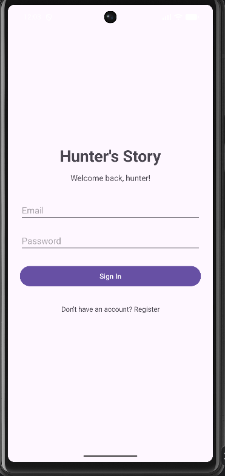
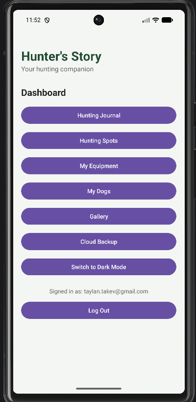
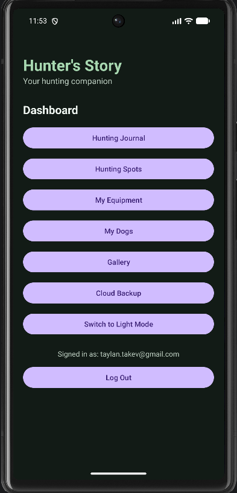
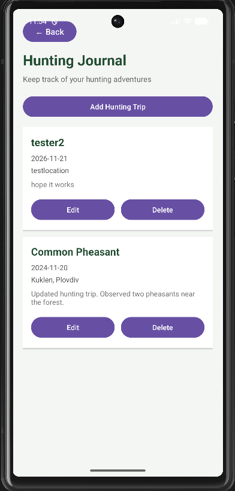
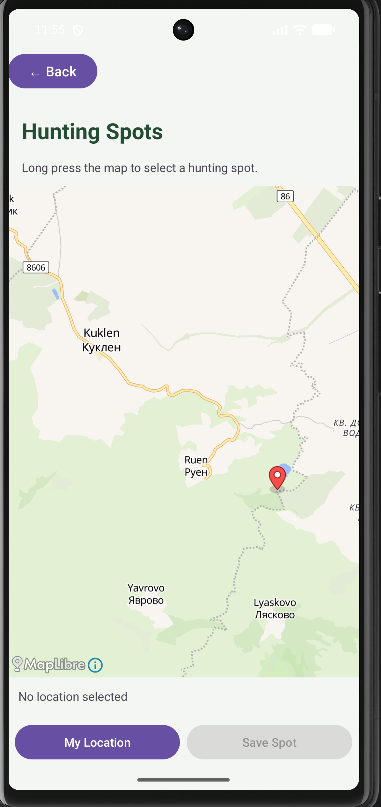
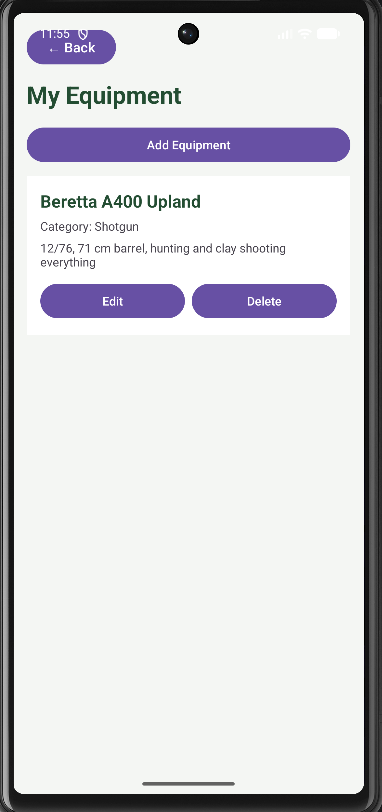
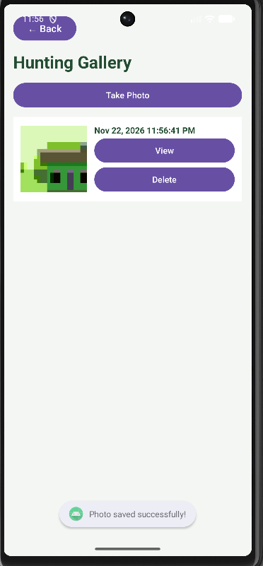
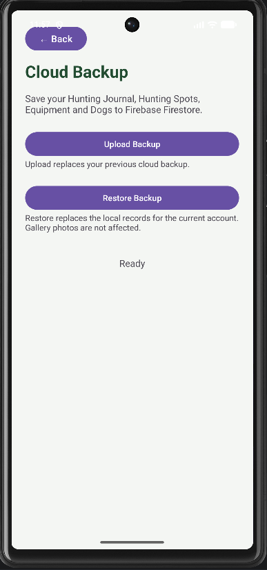

# Hunter's Story 🦌

**Hunter's Story** е Android приложение за организиране и документиране на ловни излети, места, екипировка, ловни кучета и снимки. Разработено е като курсов проект по **Мобилни приложения**.

## Идея

Приложението събира основните инструменти на ловеца на едно място: личен дневник, карта с GPS координати, списъци с екипировка и кучета, фото галерия и възможност за ръчно архивиране на данните в облака.

## Как работи

Потребителят се регистрира или влиза чрез Firebase Authentication и от Dashboard избира нужната функция. В **Hunting Journal** създава, разглежда, редактира и изтрива ловни излети с дата, място, дивеч и бележки. В **Hunting Spots** избира точка с продължително натискане върху карта MapLibre, използва GPS за текущото си местоположение и запазва ловни места. Разделите **My Equipment** и **My Dogs** позволяват управление на лични записи. Чрез **Gallery** заснема снимки с камерата и ги съхранява локално. Данните за излети, места, екипировка и кучета се пазят в Room и остават след рестартиране на приложението. **Cloud Backup** позволява ръчно качване и възстановяване на тези записи във Firebase Firestore; снимките не участват в архива. Dashboard предлага смяна между светла и тъмна тема, а потребителят може да излезе от профила си.

## Основни функционалности

- **Authentication:** регистрация, вход и изход чрез Firebase Authentication.
- **Hunting Journal:** добавяне, преглед, редактиране и изтриване на ловни излети.
- **Hunting Spots:** MapLibre карта, GPS, поставяне и запазване на точки и изтриване на записани места.
- **My Equipment:** управление на списък с ловна екипировка.
- **My Dogs:** управление на информация за ловни кучета.
- **Gallery:** снимане чрез Android Camera Intent, локално разглеждане и изтриване на снимки.
- **Cloud Backup:** ръчно качване и възстановяване на записи чрез Firebase Firestore.
- **Light/Dark Mode:** Material 3 DayNight тема и бутон за превключване от Dashboard със запазване на избора.

## Архитектура

Проектът използва **MVVM (Model–View–ViewModel)** и **Repository** подход за разделяне на интерфейса, състоянието и работата с данни.

```text
Activity / XML UI
       ↓
     ViewModel
       ↓
    Repository
       ↓
Room / Firebase / Android services
```

- **UI:** Android Activities, XML layouts, RecyclerView и Material 3.
- **ViewModel:** състояние, валидация и операции за потребителските екрани.
- **Repository:** достъп до локални и облачни източници на данни.
- **Локално съхранение:** Room (Entity, DAO, Database).
- **Облачни услуги:** Firebase Authentication и Firebase Firestore.

*Забележка:* Част от операциите в Activity класовете все още взаимодействат директно с локалния DAO; схемата показва основния архитектурен подход, а не че абсолютно всеки екран следва идентичен поток.

## Потребителски поток

```text
Login / Register
      ↓
   Dashboard
      ├── Hunting Journal → Add / Edit / Delete Trip
      ├── Hunting Spots → GPS / Select / Save / Delete Spot
      ├── My Equipment → Add / Edit / Delete
      ├── My Dogs → Add / Edit / Delete
      ├── Gallery → Take / View / Delete Photo
      ├── Cloud Backup → Upload / Restore
      ├── Light / Dark Mode
      └── Log Out
```

## Технологии

| Технология | Предназначение |
|---|---|
| Kotlin | Основен език |
| Android SDK — minSdk 24, targetSdk 37 | Android платформа |
| Material 3 / DayNight | Интерфейс и светла/тъмна тема |
| MVVM + Repository | Архитектура |
| Room 2.8.4 | Локална база данни |
| Firebase Authentication | Потребителски акаунти |
| Firebase Firestore | Ръчно облачно архивиране |
| MapLibre 13.6.1 | Карта и отбелязване на места |
| Google Play Services Location | GPS местоположение |
| Android Camera Intent | Заснемане на снимки |
| JUnit, MockK, Robolectric, Espresso | Автоматизирани тестове |
| ktlint, detekt | Проверки за качество на кода |

## Стартиране на проекта

1. Инсталирайте **Android Studio** и Android SDK с **API 37**.
2. Клонирайте проекта:

   ```bash
   git clone https://github.com/taylyan/MobileApps2026-2401321045.git
   ```

3. Отворете клонираната папка в Android Studio и изчакайте **Gradle Sync**.
4. За Firebase настройте проект с активирани **Authentication → Email/Password** и **Cloud Firestore**. Поставете съответстващия на пакета `com.huntersstory.app` файл `google-services.json` в `app/`, ако не е предоставен в работната среда. Не публикувайте администраторски ключове или реални пароли.
5. Стартирайте емулатор или Android устройство с **API 24 или по-нова**. За GPS и Firebase функциите са необходими съответните разрешения и интернет връзка.
6. Изберете **Run ▶** в Android Studio или компилирайте от терминала:

   ```powershell
   .\gradlew.bat :app:assembleDebug
   ```

7. Регистрирайте нов потребител или влезте с предоставен тестов акаунт.

## Тестови акаунти

- **Самостоятелна проверка:** отворете **Register** и създайте нов акаунт с валиден имейл и парола.
- **Акаунт за преподавателя:** при необходимост се предоставя отделно, по защитен канал. **Парола не се публикува в README.md или GitHub.**
- **Espresso тест за Hunting Journal:** използва тестов Firebase акаунт, предоставен чрез instrumentation аргументите `testEmail` и `testPassword`. Препоръчва се отделен тестов акаунт, а не личен профил с реални записи.

## Тестове и качество

Реализирани са Unit тестове и Espresso UI тестове, включително:

- `AuthenticationFlowTest` — навигация от Login към Register.
- `HuntingJournalFlowTest` — попълване на форма, запазване на ловен излет и проверка за появата му в списъка.

Команди за проверка в Windows PowerShell:

```powershell
.\gradlew.bat :app:testDebugUnitTest
.\gradlew.bat :app:ktlintCheck :app:detekt
.\gradlew.bat :app:assembleDebug
```

За Android instrumentation тестовете стартирайте емулатор и изпълнете `:app:connectedDebugAndroidTest`. За теста на Journal първо конфигурирайте неговите Firebase test credentials като instrumentation аргументи; не използвайте истински лични пароли в споделени скриптове.


## Скрийншотове


| Екран | Скрийншот |
|---|---|
| Login |  |
| Dashboard — Light Mode |  |
| Dashboard — Dark Mode |  |
| Hunting Journal |  |
| Hunting Spots |  |
| My Equipment / My Dogs |  |
| Gallery |  |
| Cloud Backup |  |

## APK

**Release APK:** [Изтегляне на `app-release.apk`](apk/app-release.apk)

> Преди предаване трябва да бъде генериран **подписан Release APK**, поставен в `apk/app-release.apk`, тестван чрез инсталация и проверен за размер **до 60 MB**. Докато файлът не бъде добавен, тази връзка няма да работи.

## Ограничения и особености

- **Cloud Backup е ръчен**, а не постоянна автоматична синхронизация.
- Облачният архив включва Journal, Spots, Equipment и Dogs, но **не включва снимките от Gallery**.
- При възстановяване съществуващите локални записи за текущия акаунт се заменят след потвърждение.
- Картата и Firebase операциите зависят от наличността на съответните мрежови услуги; локално съхранените записи остават достъпни след рестартиране.

## Авторство и проект

Курсов проект по **Мобилни приложения**.

**GitHub:** https://github.com/taylyan/MobileApps2026-2401321045
